<p align="center">
  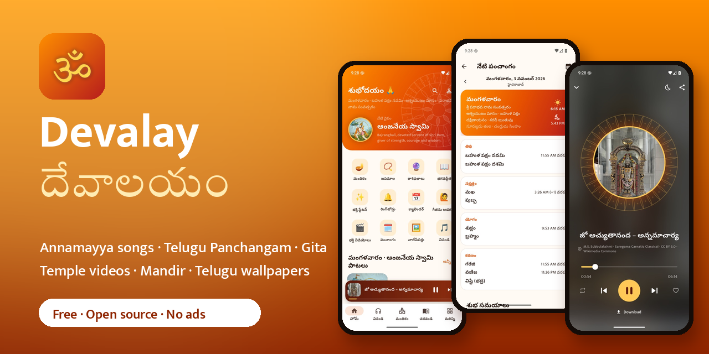
</p>

<h1 align="center">🛕 Devalay · देवालय</h1>

<p align="center">
  <b>A free, open-source, ad-free Hindu devotional app for Android, in 11 Indian languages.</b><br>
  English · हिन्दी · বাংলা · मराठी · తెలుగు · தமிழ் · ગુજરાતી · ಕನ್ನಡ · മലയാളം · ଓଡ଼ିଆ · ਪੰਜਾਬੀ<br>
  Panchang & calendar · Annamayya keerthanas · temple videos · the Bhagavad Gita · a virtual Mandir · japa mala
</p>

<p align="center">
  <a href="https://github.com/ChandraChaan/devalay/releases/latest/download/devalay.apk"></a>
  <a href="https://chandrachaan.github.io/devalay"></a>
</p>

<p align="center">
  <a href="https://github.com/ChandraChaan/devalay/releases/latest"></a>
  <a href="https://github.com/ChandraChaan/devalay/releases"></a>
  <a href="https://github.com/ChandraChaan/devalay/actions/workflows/app.yml"></a>
  <a href="https://github.com/ChandraChaan/devalay/actions/workflows/backend.yml"></a>
  <a href="LICENSE"></a>
  <a href="https://github.com/ChandraChaan/devalay/stargazers"></a>
</p>

Devalay brings the temple to your phone for every member of the family, in the language they read best:
English, हिन्दी, বাংলা, मराठी, తెలుగు, தமிழ், ગુજરાતી, ಕನ್ನಡ, മലയാളം, ଓଡ଼ିଆ or ਪੰਜਾਬੀ.

- **For grandparents:** official TTD (SVBC) temple videos in a simple swipe-up feed, and large, clear text.
- **For the Panchang reader:** a Panchang for more than 300 cities (or "Use my location"), with samvatsara, masa, tithi and nakshatra end times,
  Rahu Kalam, Yamagandam, Durmuhurtham, Varjyam and Amrit Kalam, checked against Drik Panchang. Choghadiya, Hora
  and Gowri Panchangam show the running period, and four home-screen widgets show today's tithi, Rahu Kalam,
  the running Choghadiya and the next festival. Tamil, Malayalam, Bengali and Odia solar dates, Amanta or
  Purnimanta months, and each state's public and bank holidays are on the calendar.
  Regional festivals include Bhogi, Kanuma, Varalakshmi Vratam, Bathukamma, Atla Taddi and Nagula Chavithi.
- **For the family calendar:** birthdays, anniversaries and remembrance days (taddinam) that repeat every year by
  tithi, with a reminder the evening before, and marriage matching from the birth stars. Back them up to a file,
  export them to Google Calendar, or import birthdays from your contacts.
- **For the family priest in you:** Shubha Muhurtham for marriage, griha pravesham and a vehicle, eclipses with
  Sutak, a Jatakam (birth chart) worked out on the phone, and step-by-step pooja guides with samagri checklists.
- **For the music lover:** Annamacharya and Ramadasu keerthanas by M.S. Subbulakshmi and Balamuralikrishna (CC BY
  releases by Saregama). They keep playing on the lock screen, and each weekday puts its deity's songs first:
  Monday Shiva, Saturday Venkateswara.

It also has all 701 verses of the Gita (shown in your own script), blessings written on wallpapers, festival
greeting cards with your photo, temple booking guides, a virtual Mandir, japa, Rashifal, statuses, and light and
dark themes in five colours. It is inspired by apps like
Sanatan, but Devalay is an **original** app with its own name, design, code and legally sourced content.

- **No ads, no analytics, no sign-up.** It works from the first launch. Only crash reports (Firebase Crashlytics) are collected, to fix bugs.
- **No server bill.** The public APK reads a pre-rendered API on GitHub Pages that refreshes daily.
- **Legal content only.** Every recording, painting and text is public domain or CC-licensed; see
  [CONTENT_LICENSES.md](CONTENT_LICENSES.md).

## Screenshots

New in 1.4: a calendar with Choghadiya, Hora and Gowri timings, a home-screen widget, important days, marriage
matching, and the whole app in 11 languages.

| Home | Calendar with festivals and auspicious days | Choghadiya, Hora and Gowri, with the running period | Important days |
|:-:|:-:|:-:|:-:|
| 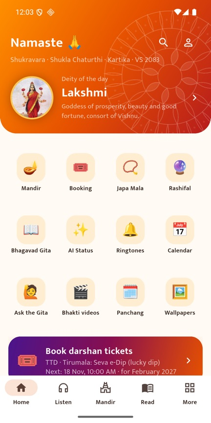 | 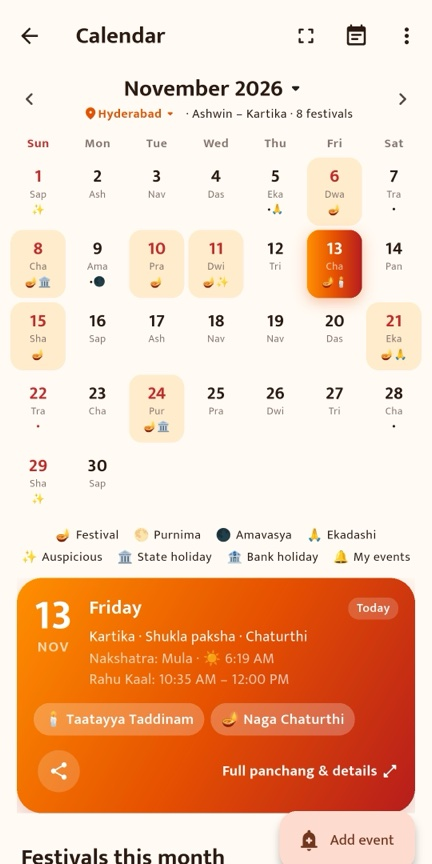 | 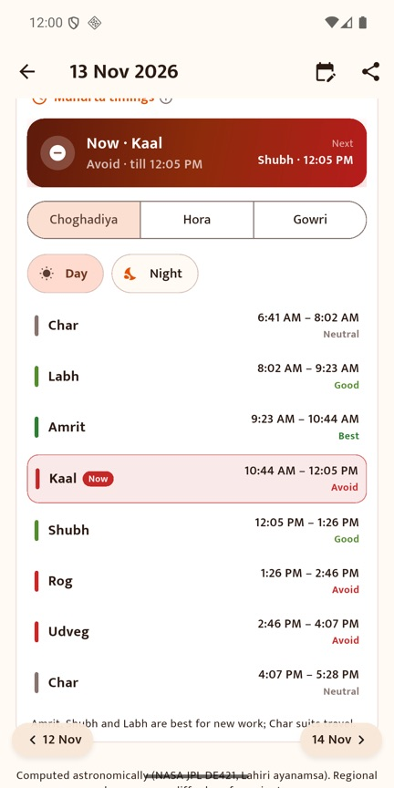 | 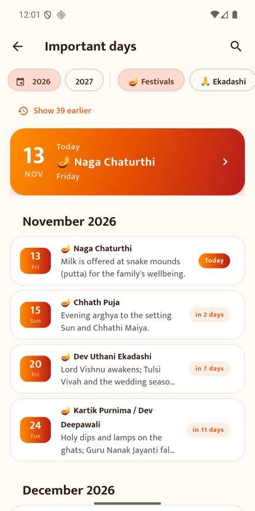 |
| **Home-screen widget** | **11 Indian languages** | **The whole app in Tamil** | **Marriage matching (Guna Milan)** |
| 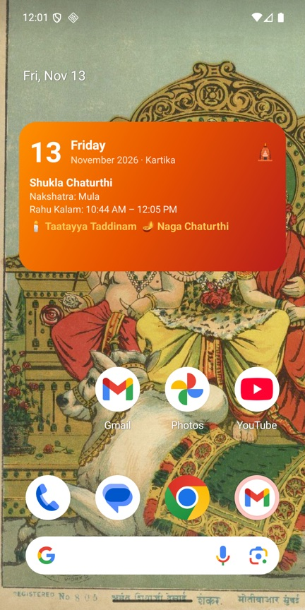 | 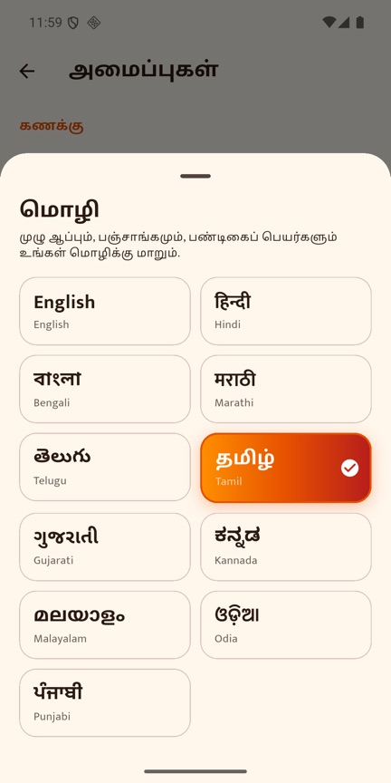 | 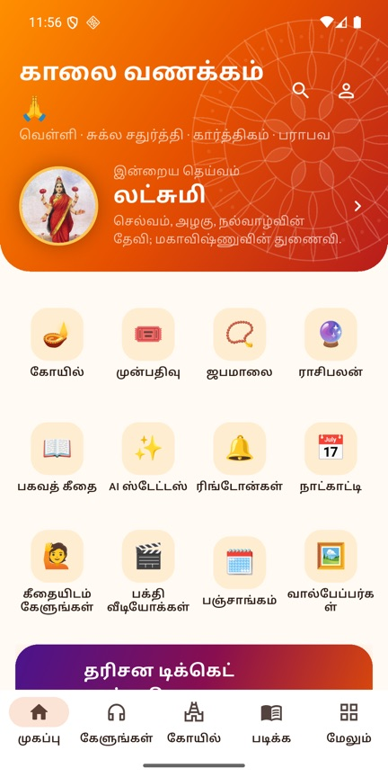 | 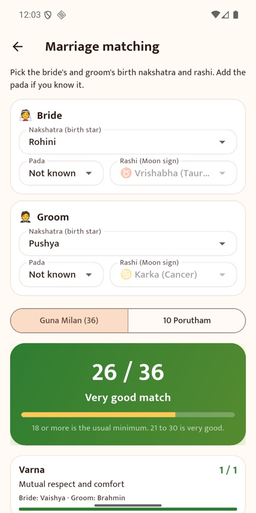 |

| Home in dark theme | Home with today's Panchang and songs | Telugu Panchangam | Good times and times to avoid |
|:-:|:-:|:-:|:-:|
| 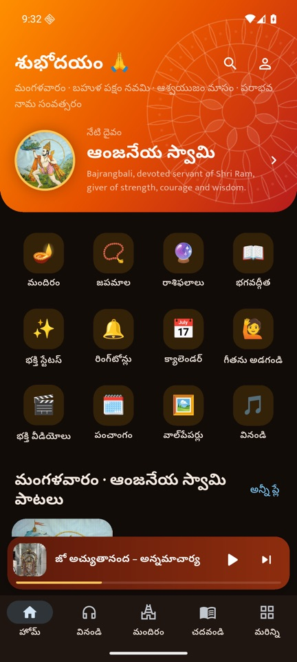 | 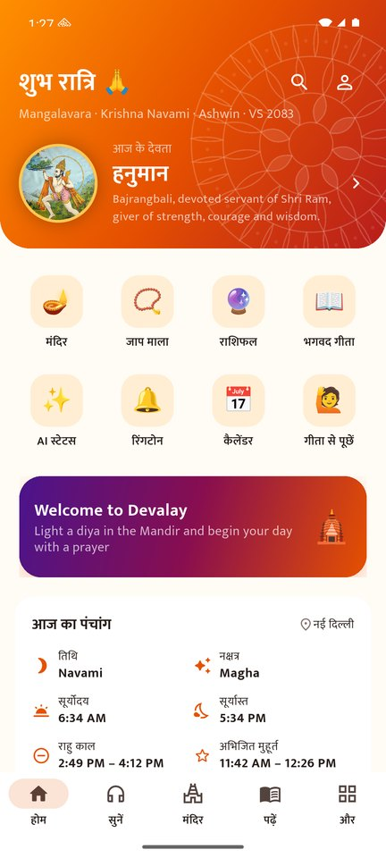 | 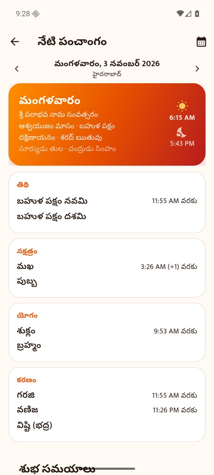 | 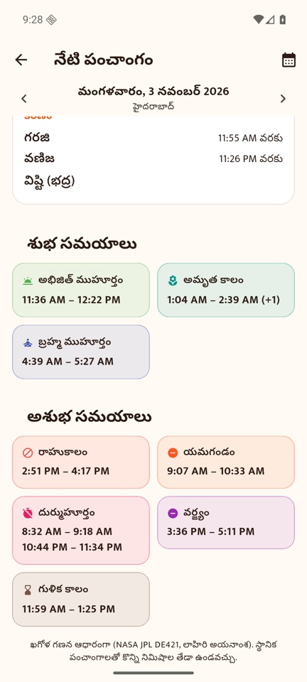 |
| **Annamacharya keerthana playing** | **Temple videos** | **Festival calendar** | **Virtual Mandir** |
| 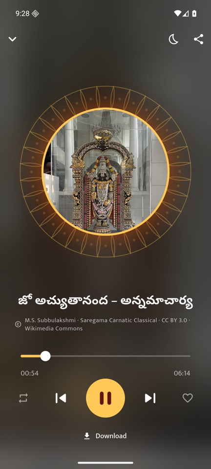 | 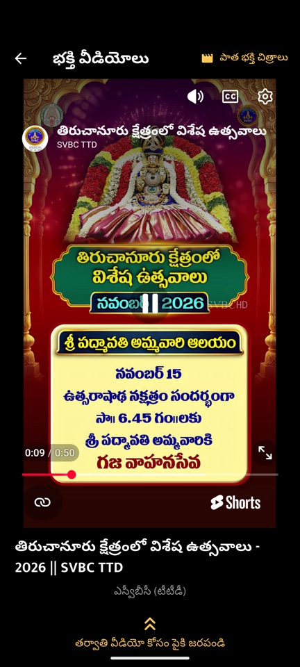 | 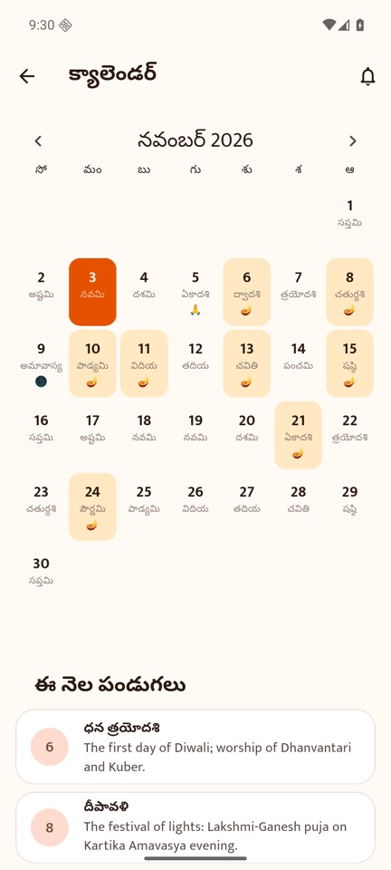 | 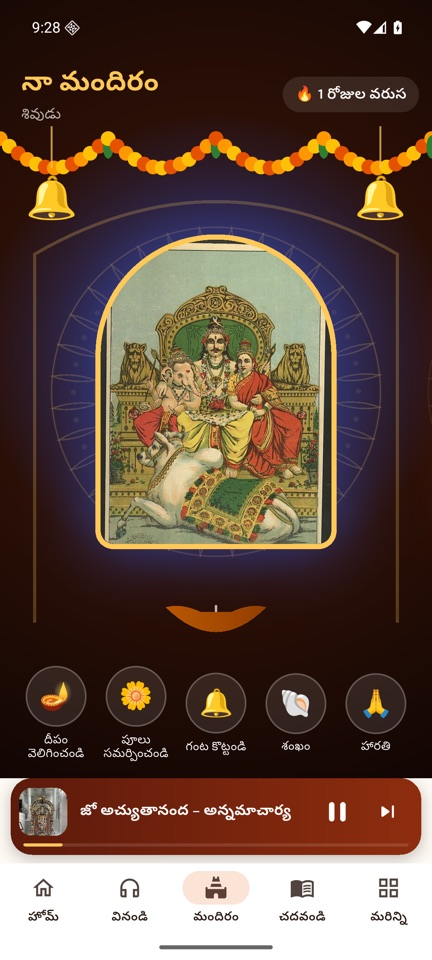 |
| **Bhagavad Gita in Telugu script** | **Telugu blessing on a wallpaper** | **Rashifal** | **Colours and themes** |
| 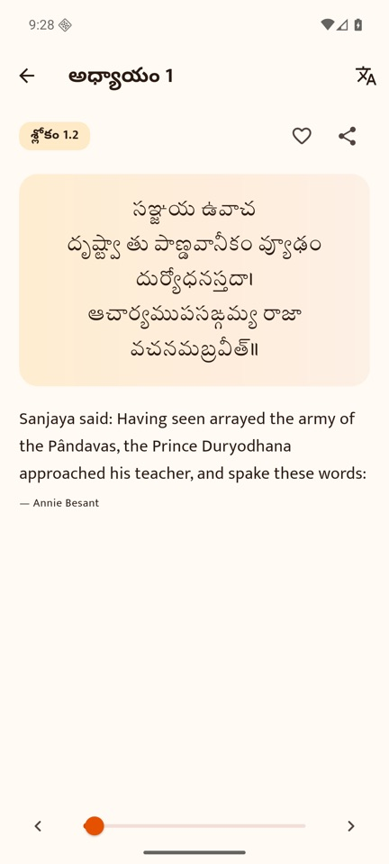 | 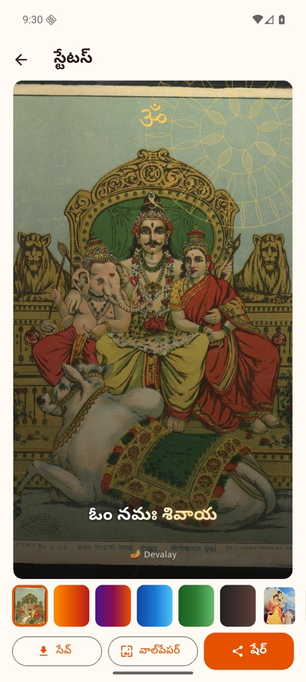 | 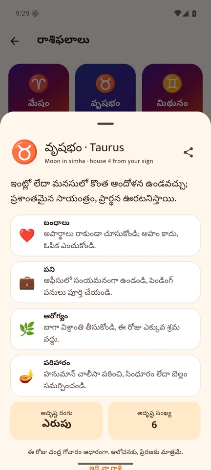 | 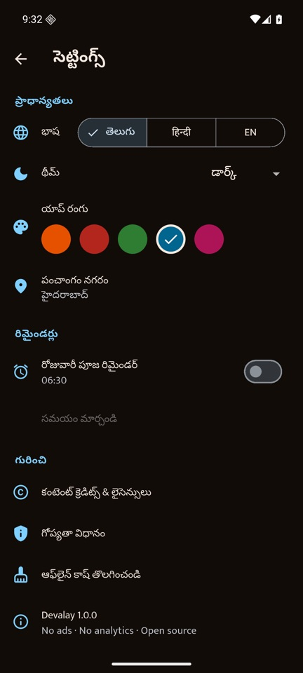 |

## Install

1. Open **[devalay.apk](https://github.com/ChandraChaan/devalay/releases/latest/download/devalay.apk)** on your
   Android phone (Android 7.0 or newer).
2. Allow your browser to install apps when Android asks, then tap **Install**.
3. Updates: download the newer APK from [Releases](https://github.com/ChandraChaan/devalay/releases). It installs
   over the old one and keeps your favourites and japa counts.

Each release lists SHA-256 checksums. `devalay-arm64-v8a.apk` is a smaller download for most phones made since 2017.

## Built with

| | |
|---|---|
| **Android app** | Flutter 3.44 · Riverpod · go_router · just_audio (background playback) · Hive (offline) |
| **Languages** | 11 Indian languages: string tables in `app/lib/l10n`, Devanagari-to-Indic script conversion, intl dates, Material localizations |
| **Home-screen widget** | Android AppWidget (Kotlin RemoteViews) fed through `home_widget` |
| **Backend** | Python 3.13 · FastAPI · SQLAlchemy 2 · PostgreSQL 17 · Alembic |
| **Admin** | SQLAdmin dashboard at `/admin` (content, media upload, users, stats) |
| **Panchang** | Skyfield + NASA JPL DE421 ephemeris, Lahiri ayanamsa |
| **Media** | Cloudflare R2 (S3 API) or local disk |
| **AI (optional)** | Claude via the Anthropic SDK, with free offline fallbacks |
| **Notifications** | On-device scheduled reminders (festivals, morning Panchang, your events); Firebase Cloud Messaging for announcements |
| **Updates and rating** | Firebase Remote Config force update, Google Play in-app updates and in-app review |
| **Download size** | About 14 MB from Google Play: split per ABI and density, R8, slim fonts, Dart symbols kept out of the app ([how](docs/DEPLOYMENT.md#02-keeping-the-download-small)) |

## Features

- **11 languages**: English, Hindi, Bengali, Marathi, Telugu, Tamil, Gujarati, Kannada, Malayalam, Odia and Punjabi,
  for every screen, Panchang name, festival, city and greeting card. Aartis, mantras and the Gita appear in your own
  script, and dates and pickers follow your language.
- **Calendar**: month grid with tithi, festivals, Ekadashi, Purnima, Amavasya, national holidays and auspicious
  days (Amrita Siddhi, Guru Pushya); Choghadiya, Hora and Gowri Panchangam; Rahu Kalam; moonrise and moonset;
  Tarabalam and Chandrabalam for your birth star; important days for the year; birthdays, anniversaries and
  remembrance days that repeat by tithi; a morning Panchang notification; and a home-screen widget.
- **Marriage matching**: Ashtakoota Guna Milan (36) and the 10 Porutham from the birth stars.
- **Home**: greeting, deity of the day, today's Panchang, festival countdown, Gita verse of the day, bhakti picks.
- **Listen**: aarti, mantra, bhajan, dhun and meditation tracks; deity filters; lock-screen controls; queue,
  repeat, sleep timer; offline downloads; lyrics link.
- **Virtual Mandir**: swipe between deities, light a flickering diya, shower flowers, ring the bells, blow the
  shankh, perform aarti with a circling thali, daily darshan streak. Works offline with bundled sounds.
- **Read**: Bhagavad Gita (701 verses: Sanskrit, IAST, English) with a swipe reader and resume; Hanuman
  Chalisa, aartis, stotras and 26 mantras with transliteration and meanings; Ramayan (493 cantos, incl. Sundar
  Kand), Mahabharata, Upanishads, *The Song Celestial*.
- **Panchang**: tithi, nakshatra, yoga, karana with end times; sunrise, sunset, moonrise and moonset; Rahu Kaal,
  Yamaganda, Gulika, Durmuhurtham, Varjyam, Abhijit, Amrit Kalam and Brahma muhurta; a tap on any term explains
  it; 45 festivals and monthly vratas computed for any year from 1902 to 2049 for more than 300 cities. A speaker button reads the day's Panchang aloud.
- **Temple booking**: every TTD online service explained, with official booking links, TTD's latest announcements
  and monthly quota reminders, plus 17 more temples and temple boards.
- **Festival wishes**: greeting cards with your photo and name for 19 occasions, ready-made wishes in every language.
- **Rashifal**: daily, weekly, monthly and yearly readings for 12 rashis from the actual transits of the Moon, Sun,
  Jupiter and Saturn, with Chandrashtamam and Sade Sati.
- **Thought of the day**: a verse a day from your language's classics (Vemana, Thirukkural, Kabir, Tukaram,
  Sarvajna, Tagore and more), each checked against a public-domain edition.
- **Japa mala**: 108-bead counter with haptics, rounds, and daily and lifetime totals.
- **AI status maker**: devotional status lines for any deity and occasion, composed over sacred art and exported
  as a 1080×1920 image to share or save.
- **Ask the Gita**: answers grounded in retrieved verses (BM25 retrieval, optional Claude synthesis).
- **Wallpapers** (set home or lock screen, save, share), **ringtones** (set as ringtone, notification or alarm),
  **classic films** (Phalke's public-domain mythologicals).
- **Search** (songs, scriptures, verses and festivals), **favourites** (offline-first, synced when signed in),
  **downloads**, light and dark themes.
- **Always current**: Google Play in-app updates, a force-update screen for very old builds, and a rate-and-share
  card in More.
- **Accounts are optional**: email and password, rotating refresh tokens, password reset, in-app account deletion.

See [docs/FEATURES.md](docs/FEATURES.md) for the full parity matrix against the reference app, including what is
intentionally not built.

In the public APK, sign-in, sync and Premium are hidden because they need the full server; everything else works.
Run your own backend (below) to enable them.

## Repository layout

```
backend/   FastAPI API, admin dashboard, Panchang engine, seed content, tests, Dockerfile
app/       Flutter Android app (lib/core, lib/features, lib/widgets, test/)
docs/      Architecture, deployment, feature matrix, store assets
site/      Landing page published to GitHub Pages with the static API
.github/   CI: backend tests, app analyze/test/build, daily Pages export, tag-triggered APK releases
```

## Quick start (local)

Backend (Python 3.12+):

```bash
cd backend
python3 -m venv .venv && .venv/bin/pip install -r requirements-dev.txt
.venv/bin/python -m app.cli init-db && .venv/bin/python -m app.cli seed
DEVALAY_PUBLIC_BASE_URL=http://10.0.2.2:8000 .venv/bin/uvicorn app.main:app --host 0.0.0.0 --port 8000
```

Open http://localhost:8000/docs for the API and http://localhost:8000/admin for the dashboard. Create an admin
(the password is read from stdin):

```bash
cd backend && .venv/bin/python -m app.cli create-admin you@example.com
```

Or run Postgres and the API together with `docker compose up --build`.

Android app (Flutter 3.44+, Android SDK 36):

```bash
cd app && flutter pub get && flutter run --dart-define=API_BASE_URL=http://10.0.2.2:8000
```

`10.0.2.2` is your computer as seen from the Android emulator. For a phone on the same Wi-Fi, use your
computer's LAN address (HTTPS is required for any non-local host).

## Tests

```bash
cd backend && .venv/bin/pytest -q && .venv/bin/ruff check .
```

```bash
cd app && flutter analyze && flutter test
```

The backend suite (74 tests) covers auth and token rotation, content APIs, admin access, AI quotas and fallbacks,
premium verification, and the Panchang engine, which is checked against published festival dates, Drik Panchang
timings and moonrise for 2025 and 2026, NASA eclipse times, and Drik's muhurtham lists. CI runs it on PostgreSQL and SQLite.

The app suite (164 tests) covers the Choghadiya, Hora and Gowri tables, tithi recurrence, Tarabalam, marriage
matching, the Jatakam against the DE421 ephemeris, regional solar dates, backup and restore, the widget and notification text, and checks that every language translates every string with the same
placeholders.

## Configuration

All backend settings are environment variables prefixed `DEVALAY_`; see
[backend/.env.example](backend/.env.example). Nothing secret is committed. Without optional keys the app still
works fully: AI uses offline generators, Play billing reports "not configured", and email reset codes are logged in
development.

## Deployment and releases

See [docs/DEPLOYMENT.md](docs/DEPLOYMENT.md):

- the serverless public build (GitHub Pages);
- cutting a release (`git tag v1.1.0 && git push --tags`);
- Render (blueprint included) or any Docker host, with Neon PostgreSQL and Cloudflare R2 for media;
- the Play Console steps.

Release history: [CHANGELOG.md](CHANGELOG.md).

## Contributing

Contributions are welcome. You could:

- add public-domain chalisas, aartis and stotras;
- translate Devalay into another language, or improve a translation (see below);
- add cities to the Panchang;
- pick up an item from the [milestones](https://github.com/ChandraChaan/devalay/milestones).

### Adding or improving a language

1. Run `python3 tool/l10n/extract.py` in `app/`. It lists every string to translate in `tool/l10n/strings.json`
   (UI and Panchang names), `strings_content.json` (wishes and the temple guide) and `strings_descriptions.json`.
2. Copy `app/lib/l10n/kn.dart`, `kn_content.dart` and `kn_desc.dart` to your language code and translate the values.
   Keep the English keys and the `{0}` placeholders exactly as they are.
3. Add the language to `appLanguages` in `app/lib/core/languages.dart` and to the table in `app/lib/l10n/l10n.dart`.
4. `flutter test test/l10n_test.dart` tells you if anything is missing.

Please open an issue first for larger changes. Any new content must be public domain or under an open licence, with
its source recorded in [CONTENT_LICENSES.md](CONTENT_LICENSES.md).

If Devalay brings you a moment of peace, **please ⭐ star the repo** and share the APK with family. Both help others
find it.

## Licences

Code: MIT. Content: public domain, CC0 or CC BY/BY-SA, credited per item; see
[CONTENT_LICENSES.md](CONTENT_LICENSES.md).
